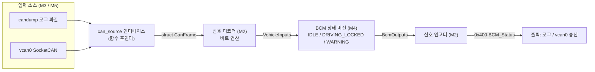

# 🗺️ can-bcm-simulator 학습 로드맵

> 웹 백엔드(Java/Spring) 개발자가 **C 언어 + 차량 CAN 통신 + 임베디드 제어 로직**을
> 처음부터 공부하며 BCM(Body Control Module) 시뮬레이터를 완성하기 위한 로드맵입니다.

## 진행 방식

1. 마일스톤은 **M0 → M6 순서**로 진행합니다. (M5 SocketCAN은 M3/M4가 끝난 뒤에)
2. 이슈 하나 = 브랜치 하나 = PR 하나. 예) `feat/M2-1-get-bits`
3. 각 이슈의 **"학습 키워드"를 먼저 공부 → `docs/notes/`에 노트 작성 → 구현** 순서로 진행합니다.
   노트는 나중에 면접에서 "이걸 왜 이렇게 했나요?"에 답하는 재료가 됩니다.
4. 이슈를 닫기 전에 **완료 조건(DoD)** 체크박스를 모두 채웁니다.
5. 막히면 이슈 코멘트에 "시도한 것 / 결과 / 추측"을 남깁니다. (트러블슈팅 기록 = 포트폴리오)

## 마일스톤 한눈에 보기

| 마일스톤 | 주제 | 핵심 산출물 | 예상 기간 |
| --- | --- | --- | --- |
| [M0](https://github.com/soheeGit/can-bcm-simulator/milestone/1) | 개발 환경 & C 기초 | Makefile, 테스트 매크로, C 학습 노트 | 4~6일 |
| [M1](https://github.com/soheeGit/can-bcm-simulator/milestone/2) | CAN 프로토콜 이해 & 데이터 모델 | `CanFrame` 구조체, 신호 정의서 | 2~3일 |
| [M2](https://github.com/soheeGit/can-bcm-simulator/milestone/3) | 신호 디코더(파서) | 비트 추출/삽입 함수, 신호별 디코더 | 3~4일 |
| [M3](https://github.com/soheeGit/can-bcm-simulator/milestone/4) | 파일 I/O 기반 로그 처리 | candump 로그 파서, 시나리오 로그, CLI | 3~4일 |
| [M4](https://github.com/soheeGit/can-bcm-simulator/milestone/5) | BCM 상태 머신(FSM) | FSM, 자동잠금/경고/Fail-safe, BCM 송신 프레임 | 4~5일 |
| [M5](https://github.com/soheeGit/can-bcm-simulator/milestone/6) | Linux SocketCAN 연동 (심화) | vcan0 실시간 수신/송신 루프 | 4~6일 |
| [M6](https://github.com/soheeGit/can-bcm-simulator/milestone/7) | 품질 & 포트폴리오 | CI, 정적분석, README, 회고 | 2~3일 |

> 기획안의 "3~5일"은 C에 익숙한 사람 기준입니다. 공부하면서 진행하면 **3~5주**를 잡는 게 현실적입니다.

## 최종 아키텍처 (목표)



## 목표 디렉터리 구조

```
can-bcm-simulator/
├── include/          # 헤더 (.h) — Java의 interface/선언부 역할
├── src/              # 구현 (.c)
├── tests/            # 단위 테스트
├── data/scenarios/   # 시나리오 CAN 로그 (candump -l 형식)
├── docs/
│   ├── ROADMAP.md
│   ├── notes/        # 내가 쓰는 학습 노트
│   └── signal-spec.md  # 신호 정의서 (M1에서 작성)
├── scripts/
└── Makefile
```

## Java/Spring ↔ 이 프로젝트 개념 대응표

| 웹 백엔드에서 알던 것 | 이 프로젝트에서 대응되는 것 |
| --- | --- |
| HTTP 요청/응답 바디(JSON) | CAN 프레임의 8바이트 data payload |
| API 스펙 문서 (OpenAPI) | 신호 정의서 (DBC 파일의 축소판) |
| DTO 역직렬화 (Jackson) | 비트 연산 기반 신호 디코딩 |
| 주문 상태 enum + 상태 전이 | BCM FSM (switch-case) |
| interface + 구현체 (DI) | 함수 포인터 구조체 (`can_source`) |
| JUnit | 직접 만든 assert 매크로 / Unity |
| Gradle | Makefile |
| 타임아웃·서킷브레이커 | 신호 미수신 타임아웃 → Fail-safe |
| GC가 메모리 관리 | 내가 직접 관리 (정적 할당 위주) |

## 이슈 관리

마일스톤과 이슈는 [GitHub Issues](https://github.com/soheeGit/can-bcm-simulator/issues)에서 관리합니다.
새 작업은 `.github/ISSUE_TEMPLATE/study-task.md` 템플릿으로 추가합니다.
