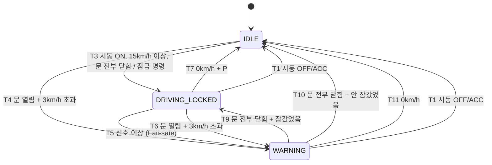

# BCM 상태 머신 설계 (FSM Design)

> M4의 기준 문서. 코드(`src/bcm.c`, M4-3)와 테스트(M4-7)는 **이 문서의 표를 그대로** 옮긴다.
> 문서와 코드가 다르면 코드가 틀린 것이다. 규칙을 바꿀 때는 이 문서를 먼저 고친다.
> 입력 신호의 정의는 [signal-spec.md](signal-spec.md), 검증 시나리오는 [data/scenarios/README.md](../data/scenarios/README.md).

## 1. BCM이 하는 일

| 기능 | 내용 |
| --- | --- |
| 자동 도어 잠금 | 시동이 켜진 채 15 km/h 이상으로 달리기 시작하면 문을 잠근다 |
| 주행 중 도어 열림 경고 | 달리는 중(3 km/h 초과)에 문이 열리면 경고음을 울린다 |
| Fail-safe | 판단에 필요한 신호가 끊기거나 무효이면, 마지막 값을 믿지 않고 경고 상태로 간다 |
| 상태 송신 | 위 결과를 0x400 BCM_STATUS로 알린다 (M4-8) |

## 2. 상태 (State)

| 상태 | 값 (0x400 BcmState) | 뜻 | 경고음 |
| --- | --- | --- | --- |
| `IDLE` | 0 | 정차/주차, 또는 시동 꺼짐. 아무것도 안 함 | OFF |
| `DRIVING_LOCKED` | 1 | 주행 중, 문을 잠근 상태 | OFF |
| `WARNING` | 2 | 경고 중 (문 열림 주행, 또는 신호 이상) | **ON** |

- 시작 상태: `IDLE`
- 0x400의 값 3은 예약 → 이 FSM이 3을 만들 일은 없다. 코드에서 알 수 없는 상태가 되면 `IDLE`로 돌아간다 (`default:`, M4-3)

### 상태와 별도로 기억하는 것: `locked`

`WARNING`에서 빠져나올 때 **어디로 돌아갈지** 알려면 "문을 잠갔었는가"를 기억해야 한다.

| 변수 | 켜짐 | 꺼짐 |
| --- | --- | --- |
| `locked` | `IDLE → DRIVING_LOCKED`로 잠금 명령을 낼 때 | `IDLE`로 들어갈 때 |

- 잠금 **해제** 명령은 이 프로젝트 범위 밖이다 (0x400에 해제 신호가 없다. 운전자가 직접 연다). `IDLE`로 가면 "잠갔다"는 **기억만** 지운다

## 3. 입력에서 만드는 판단 조건

`VehicleInputs`(M2-6)와 현재 시각 `now_ms`로 매 판단마다 아래 조건을 계산한다.

| 상수 | 값 | 이유 |
| --- | --- | --- |
| `BCM_LOCK_SPEED` | 15.00 km/h (`1500` centi) | 자동 잠금 시작 속도 (실차에서 흔한 값) |
| `BCM_MOVING_SPEED` | 3.00 km/h (`300` centi) | 이보다 빠르면 "달리는 중". 주차하며 천천히 움직일 때 문을 여는 건 허용 |
| `BCM_SIGNAL_TIMEOUT_MS` | 500 ms | 100ms 주기 × 5 (signal-spec 공통 규칙) |

| 조건 | 정의 |
| --- | --- |
| *X* 끊김 (timeout) | *X*를 한 번도 못 받았거나, `now_ms - X_rx_ms > 500` |
| `ign_known` | 시동 신호가 끊기지 않음 |
| `ign_run` | `ign_known` 이고 `IGN_ON` 또는 `IGN_START` |
| `ign_stop` | `ign_known` 이고 `IGN_OFF` 또는 `IGN_ACC` |
| `speed_known` | 차속이 끊기지 않았고 `valid` (0xFFFF가 아님) |
| `doors_known` | 도어 신호가 끊기지 않음 |
| **`inputs_ok`** | `ign_known && speed_known && doors_known` (판단에 필요한 신호가 전부 믿을 만함) |
| `door_open` | `doors_known` 이고 문이 하나라도 열림 (트렁크 포함, `door_any_open`) |
| `all_closed` | `doors_known` 이고 문이 전부 닫힘 |
| `speed` | `speed_known`일 때의 차속 (centi_kmh) |

- **기어는 `inputs_ok`에 넣지 않는다.** 기어는 "정차 후 `IDLE`로 돌아갈지" 판단에만 쓰고, 모르면(`GEAR_INVALID`) **돌아가지 않을 뿐**이다. 모르는 채로 그 자리에 있는 게 안전하다
- `ACC`는 "시동 꺼짐"으로 본다. 라디오만 켜진 상태라 주행할 수 없다

## 4. 상태 전이 표 (State Transition Table)

**위에서부터 차례로 확인하고, 처음 맞는 줄 하나만** 실행한다 (우선순위). 맞는 줄이 없으면 상태를 유지한다.

| # | 현재 상태 | 조건 (guard) | 다음 상태 | 동작 (action) |
| --- | --- | --- | --- | --- |
| T1 | **모든 상태** | `ign_stop` | `IDLE` | 출력 초기화, `locked = false` |
| T2 | `IDLE` | `!inputs_ok` | (유지) | 아무것도 안 함. 모르는 채로 잠그지 않는 것 = IDLE의 Fail-safe |
| T3 | `IDLE` | `ign_run && speed ≥ 15 && all_closed` | `DRIVING_LOCKED` | **도어 잠금 명령 1회**, `locked = true` |
| T4 | `IDLE` | `ign_run && door_open && speed > 3` | `WARNING` | 경고음 ON |
| T5 | `DRIVING_LOCKED` | `!inputs_ok` | `WARNING` | 경고음 ON (**Fail-safe**) |
| T6 | `DRIVING_LOCKED` | `door_open && speed > 3` | `WARNING` | 경고음 ON |
| T7 | `DRIVING_LOCKED` | `speed == 0 && gear == P` | `IDLE` | `locked = false` |
| T8 | `WARNING` | `!inputs_ok` | (유지) | 경고음 유지 (신호가 돌아올 때까지) |
| T9 | `WARNING` | `all_closed && locked` | `DRIVING_LOCKED` | 경고음 OFF (잠금 명령은 다시 안 냄) |
| T10 | `WARNING` | `all_closed && !locked` | `IDLE` | 경고음 OFF |
| T11 | `WARNING` | `speed == 0` | `IDLE` | 경고음 OFF, `locked = false` |

### 초안에서 바뀐 것

| 초안 | 확정 | 이유 |
| --- | --- | --- |
| 타임아웃이면 "모든 상태"에서 `WARNING` | `IDLE`에서는 유지 (T2) | 시동 직후에는 아직 아무 신호도 안 왔다. 정차 중 신호가 끊겼다고 경고음을 울릴 이유가 없다. IDLE은 잠그지 않으므로 이미 안전하다 |
| 시동 OFF만 `IDLE` | OFF **또는 ACC** (T1) | ACC는 주행 불가 상태 |
| `WARNING` → `DRIVING_LOCKED`: 문 닫힘 **&& speed > 3** | 문 닫힘이면 `locked`에 따라 돌아감 (T9, T10) | 초안대로면 문을 닫았는데 1~3 km/h이면 경고음이 계속 울린다 (정의 안 된 조합) |
| (없음) | `IDLE`에서 문 열고 출발 → `WARNING` (T4) | 이슈의 "표에 없는 조합". 잠갔든 안 잠갔든 문 열고 달리는 건 위험하다 |
| (없음) | 끊긴 신호 = 차속 무효(0xFFFF)도 포함 | "값이 안 옴"과 "값이 모름이라고 옴"은 BCM 입장에서 같다 |

## 5. 상태 다이어그램

## 6. 출력 (BcmOutputs)

| 출력 | 정하는 방법 | 종류 |
| --- | --- | --- |
| `state` | 현재 상태 | 상태로 정해짐 (Moore) |
| `warning_buzzer` | `state == WARNING` 이면 ON | 상태로 정해짐 (Moore) |
| `door_lock_cmd` | **T3이 실행된 그 판단에서만** 1, 나머지는 0 | 전이할 때만 (Mealy) |

- 잠금 명령은 **진입할 때 1회** (M4-4 결정): 잠금은 모터를 돌리는 동작이라, 상태가 유지되는 동안 계속 보내면 매 100ms마다 잠금을 반복하게 된다
- 그래서 `WARNING → DRIVING_LOCKED`(T9)로 돌아올 때는 다시 보내지 않는다 (이미 잠겨 있다)

## 7. 히스테리시스 (경계에서 깜빡임 방지)

차속이 15 km/h 근처에서 14.9 ↔ 15.1을 오가도 잠금/해제가 반복되지 않아야 한다.

| 방향 | 조건 |
| --- | --- |
| 잠금 (IDLE → DRIVING_LOCKED) | 15 km/h **이상** |
| 해제 (DRIVING_LOCKED → IDLE) | **0 km/h + P단** |

- 들어가는 문턱(15)과 나오는 문턱(0 + P)이 멀리 떨어져 있어서, 15 근처에서 흔들려도 상태가 안 바뀐다
- 경고도 같다: 들어갈 때 3 km/h **초과**, 문이 열린 채로 나갈 때는 **0 km/h** (T11). 1~3 km/h에서 흔들려도 경고음이 깜빡이지 않는다
- 에어컨 온도 조절(26도에 켜고 24도에 끄기)과 같은 원리

## 8. 언제 판단하나

- 파일 모드: 프레임을 하나 받아 디스패처가 처리할 때마다 `bcm_step(ctx, inputs, now_ms, out)`를 1번 부른다
- 타임아웃은 **다른 메시지가 들어올 때** 확인된다 (0x100이 끊겨도 0x300, 0x200은 100ms마다 오므로 늦어도 100ms 안에 알아챈다)
- 실시간 모드(M5)에서는 프레임이 없어도 주기적으로(예: 10ms) `bcm_step`을 부른다

## 9. 시나리오 대입 (기대 결과)

| 시나리오 | 상태 변화 | 해당 규칙 |
| --- | --- | --- |
| 01 정상 주행 | 0.0 IDLE → **1.8 DRIVING_LOCKED** (잠금 1회) → **9.5 IDLE** | T3, T7 |
| 02 주행 중 문 열림 | 1.8 DRIVING_LOCKED → **4.0 WARNING** → **5.0 DRIVING_LOCKED** → 9.5 IDLE | T3, T6, T9, T7 |
| 03 차속 끊김 | 1.3 DRIVING_LOCKED → **3.5 WARNING** (2.9 마지막 수신 + 500ms 초과) → **4.0 DRIVING_LOCKED** → 7.5 IDLE | T3, T5, T9, T7 |
| 04 이상한 프레임 | 0.8 DRIVING_LOCKED → **1.8 WARNING** (차속 0xFFFF) → **1.9 DRIVING_LOCKED** → 2.2 기어 무효는 변화 없음 → (끝까지 DRIVING_LOCKED) | T3, T5, T9 |

- 03: 3.4초에는 경과 시간이 정확히 500ms라 아직 끊김이 아니다 (`> 500`). 3.5초에 0x300이 들어올 때 600ms → 끊김
- 04: 깨진 줄(파싱 실패, DLC 부족)은 디스패처가 값을 바꾸지 않으므로(M2-6) FSM도 반응하지 않는다

## 10. 나중에 정할 것

| 항목 | 이슈 |
| --- | --- |
| 도어 신호 디바운싱 (3회 연속 같은 값일 때만 인정) → 02의 WARNING 진입이 4.2초로 늦어짐 | M4-5 |
| 상태 전이 로그 형식 `STATE IDLE -> DRIVING_LOCKED (T3: speed>=15)` | M4-3 |

## 변경 이력

| 이슈 | 내용 |
| --- | --- |
| M4-1 | 최초 작성. 초안 표를 검토해 T1~T11로 확정, `locked` 기억 추가 |
